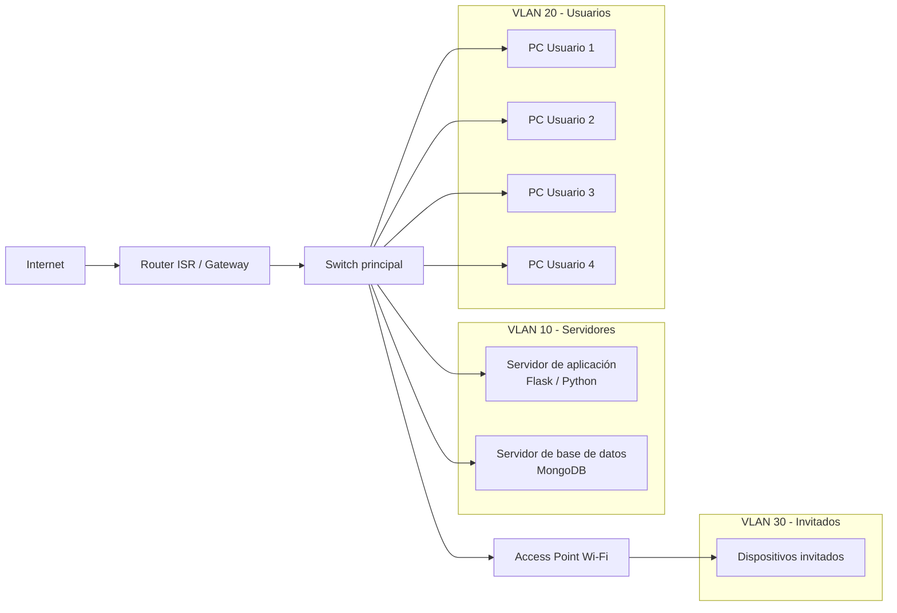

# REDES: La última letra

## 1. Organización y alcance

La aplicación `La última letra` se desarrolla para un centro de formación digital o institución educativa que ofrece actividades de programación y juegos interactivos. La infraestructura debe soportar un servidor de aplicación Flask, un servidor de base de datos MongoDB, puestos de usuarios cableados y una red Wi‑Fi para invitados, manteniendo la seguridad y el aislamiento entre segmentos.

La solución propuesta contempla una red jerárquica con:

- 1 router de salida a Internet.
- 1 switch principal con VLANs.
- 1 punto de acceso Wi‑Fi para usuarios e invitados.
- 1 servidor de aplicación.
- 1 servidor de base de datos.
- 4 o más PCs de usuarios.

## 2. Topología lógica



## 3. Plan de direccionamiento IP (VLSM)

Se trabaja con el bloque privado asignado al grupo 3:

- 192.168.3.0/24

Se divide el bloque en subredes según la cantidad de hosts necesarios por VLAN.

| VLAN (ID y nombre) | Red / Prefijo | Máscara | Rango de hosts | Gateway | Hosts útiles |
|---|---|---:|---|---|---:|
| 10 – Servidores | 192.168.3.0/28 | 255.255.255.240 | 192.168.3.1 – 192.168.3.14 | 192.168.3.1 | 14 |
| 20 – Usuarios | 192.168.3.16/28 | 255.255.255.240 | 192.168.3.17 – 192.168.3.30 | 192.168.3.17 | 14 |
| 30 – Invitados | 192.168.3.32/27 | 255.255.255.224 | 192.168.3.33 – 192.168.3.62 | 192.168.3.33 | 30 |

### Distribución de equipos

- VLAN 10 – Servidores
  - Servidor de aplicación: 192.168.3.2
  - Servidor de base de datos: 192.168.3.3
  - DNS interno: 192.168.3.4 (opcional)
  - Switch y router: IP de gestión en la VLAN de servidores

- VLAN 20 – Usuarios
  - PC1: DHCP 192.168.3.18 a 192.168.3.20
  - PC2: DHCP 192.168.3.21 a 192.168.3.23
  - PC3: DHCP 192.168.3.24 a 192.168.3.26
  - PC4: DHCP 192.168.3.27 a 192.168.3.29
  - Gateway: 192.168.3.17
  - Pool DHCP: 192.168.3.18 – 192.168.3.30

- VLAN 30 – Invitados
  - Dispositivos Wi‑Fi: DHCP de 192.168.3.34 a 192.168.3.62
  - Gateway: 192.168.3.33
  - Pool DHCP: 192.168.3.34 – 192.168.3.62

### Justificación del diseño

Se decidió usar VLSM para evitar desperdiciar direcciones IP:

- La VLAN de servidores necesita pocos hosts, pero requiere IPs fijas para servicios críticos.
- La VLAN de usuarios necesita varios equipos y una asignación automática por DHCP.
- La VLAN de invitados requiere acceso a Internet y acceso limitado a la red interna, por lo que se deja con un rango más amplio pero separado.

## 4. Segmentación y configuración de VLANs

### VLANs propuestas

- VLAN 10 – Servidores
- VLAN 20 – Usuarios
- VLAN 30 – Invitados

### Configuración conceptual en switch

```text
vlan 10
 name SERVIDORES
vlan 20
 name USUARIOS
vlan 30
 name INVITADOS

interface range fa0/1-4
 switchport mode access
 switchport access vlan 20

interface fa0/5
 switchport mode access
 switchport access vlan 10

interface fa0/6
 switchport mode access
 switchport access vlan 30

interface g0/1
 switchport mode trunk
 switchport trunk allowed vlan 10,20,30
```

### Router-on-a-stick

El router debe recibir la interconexión del switch por una interfaz troncal y crear subinterfaces para cada VLAN.

```text
interface GigabitEthernet0/0
 no shutdown

interface GigabitEthernet0/0.10
 description VLAN 10 - SERVIDORES
 encapsulation dot1Q 10
 ip address 192.168.3.1 255.255.255.240

interface GigabitEthernet0/0.20
 description VLAN 20 - USUARIOS
 encapsulation dot1Q 20
 ip address 192.168.3.17 255.255.255.240

interface GigabitEthernet0/0.30
 description VLAN 30 - INVITADOS
 encapsulation dot1Q 30
 ip address 192.168.3.33 255.255.255.224
```

## 5. DHCP para usuarios e invitados

### DHCP - VLAN 20 (Usuarios)

```text
dhcp pool VLAN20_USUARIOS
 network 192.168.3.16 255.255.255.240
 default-router 192.168.3.17
 dns-server 192.168.3.4
 domain-name expotecnica.local
 lease 7
```

### DHCP - VLAN 30 (Invitados)

```text
dhcp pool VLAN30_INVITADOS
 network 192.168.3.32 255.255.255.224
 default-router 192.168.3.33
 dns-server 192.168.3.4
 domain-name expotecnica.local
 lease 1
```

### Excepciones

Las IPs fijas de los servidores deben estar excluidas de los pools DHCP:

- 192.168.3.2 – servidor de aplicación
- 192.168.3.3 – servidor de MongoDB
- 192.168.3.4 – DNS interno

## 6. Servicios de red requeridos

### DNS

Se implementa un servidor DNS interno que resuelve el nombre del servicio web.

Ejemplo:

- app.expotecnica.local -> 192.168.3.2
- db.expotecnica.local -> 192.168.3.3

### HTTP / Flask

El servidor de aplicación corre la app web del juego en el puerto 5000 o 80, según la configuración final. La red debe permitir acceso desde PCs de usuarios y, si corresponde, desde el router para salida a Internet.

### MongoDB

MongoDB corre en el servidor de base de datos y escucha en el puerto 27017. Debe permitirse solo desde el servidor de aplicación para evitar accesos no autorizados desde usuarios o invitados.

## 7. ACLs (lista de control de acceso)

Las reglas de seguridad propuestas son las siguientes:

1. La VLAN de invitados no puede acceder a la VLAN de servidores.
2. La VLAN de usuarios solo puede acceder al servidor de aplicación en el puerto HTTP (80 o 5000).
3. El puerto TCP 27017 de MongoDB solo es accesible desde el servidor de aplicación.

### ACL conceptual

```text
! Bloquea acceso de invitados a servidores
access-list 101 deny ip 192.168.3.32 0.0.0.31 192.168.3.0 0.0.0.15

! Permite acceso Web de usuarios al servidor de aplicación
access-list 101 permit tcp 192.168.3.16 0.0.0.15 host 192.168.3.2 eq 80
access-list 101 permit tcp 192.168.3.16 0.0.0.15 host 192.168.3.2 eq 5000

! Permite MongoDB desde el servidor de aplicación hacia la base de datos
access-list 101 permit tcp host 192.168.3.2 host 192.168.3.3 eq 27017

! Resto del tráfico queda bloqueado o se aplica política por defecto
access-list 101 deny ip any any
```

Aplicación sugerida en la interfaz del router:

```text
interface GigabitEthernet0/0.20
 ip access-group 101 in

interface GigabitEthernet0/0.30
 ip access-group 101 in
```

## 8. Conectividad y pruebas de red

Las pruebas mínimas que deben validarse en Packet Tracer o en laboratorio son:

- Ping desde PC de usuarios hacia el servidor de aplicación: OK.
- Ping desde PC de usuarios hacia el servidor de MongoDB: bloqueado, salvo el puerto específico 27017 y solo desde el servidor App.
- Ping desde un dispositivo invitado hacia un servidor: fallido.
- Ping desde un usuario a una dirección de Internet: OK, si se configura NAT/PAT.
- Tracert desde VLAN 20 hacia VLAN 10: muestra el paso por el router y la entrega al host correcto.
- Tracert desde VLAN 30 hacia VLAN 10: fallido por la ACL.

### Ejemplos de validación

```text
PC1> ping 192.168.3.2
PC1> ping 192.168.3.3
PC2> tracert 192.168.3.2
INVITADO> ping 192.168.3.2
```

## 9. Conexión a Internet

Para permitir la salida a Internet se recomienda aplicar NAT/PAT en el router:

```text
ip nat inside source list NAT-OUT overloading

interface GigabitEthernet0/0
 ip nat outside

interface GigabitEthernet0/0.20
 ip nat inside

interface GigabitEthernet0/0.10
 ip nat inside
```

Esto permite que los usuarios naveguen por Internet pero mantenga la separación con la VLAN de invitados y la VLAN de servidores.

## 10. Seguridad adicional recomendada

- Contraseñas cifradas en dispositivos Cisco (`enable secret`, `service password-encryption`).
- Banner de advertencia legal.
- Acceso remoto por SSH, no por Telnet.
- WPA2 en la red Wi‑Fi.
- Port Security en los puertos de acceso del switch.
- VLAN de invitados aislada y sin acceso a recursos internos.

## 11. Conclusión

La arquitectura propuesta permite cumplir los requisitos del proyecto: mantiene la aplicación Flask y la base de datos MongoDB separadas del tráfico general, habilita acceso controlado para usuarios, y evita que los invitados accedan a la infraestructura crítica. El diseño con VLANs, VLSM, DHCP y ACL responde a las necesidades reales del juego web `La última letra` y a la lógica de una organización pequeña con servicios internos y salida a Internet.
