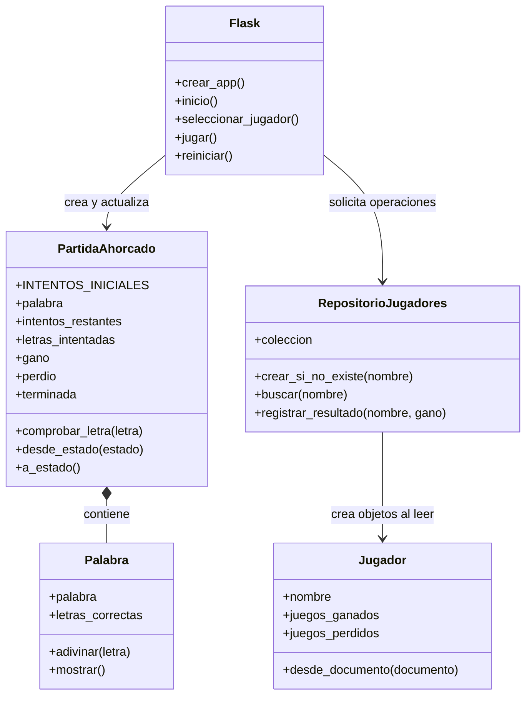

# Cómo funciona el juego del ahorcado

Este documento explica, paso a paso y con palabras sencillas, cómo está
organizado el programa, cómo se juega y qué información se guarda en MongoDB.

## 1. Resumen del programa

El proyecto tiene tres partes que colaboran:

1. **La página web** muestra formularios, la palabra, los intentos y los
   resultados.
2. **Los objetos de Python** representan al jugador, la palabra y la partida.
   Aquí se aplican las reglas del ahorcado.
3. **MongoDB** conserva el nombre de cada jugador y el total de partidas
   ganadas y perdidas.

El navegador envía cada acción al programa Flask. Flask recupera la partida,
llama a los objetos para procesar la letra y vuelve a mostrar la página
actualizada.

## 2. Diagrama de clases

El siguiente diagrama muestra los objetos principales y cómo se relacionan:



### Qué hace cada clase

- **`Jugador`** representa a una persona que juega. Tiene su nombre y dos
  contadores. El método `desde_documento` convierte los datos leídos de
  MongoDB en un objeto `Jugador`.
- **`Palabra`** guarda la palabra secreta y las letras correctas. `adivinar`
  agrega una letra acertada y `mostrar` construye la versión visible, por
    ejemplo `C__P__A____`; los espacios y signos se muestran automáticamente.
- **`PartidaAhorcado`** administra una ronda: conserva la palabra, los
  intentos y las letras usadas; revisa si se ganó, se perdió o la ronda terminó.
  `a_estado` y `desde_estado` convierten la partida a un formato que se puede
  guardar y recuperar entre visitas del navegador.
- **`RepositorioJugadores`** se ocupa de leer y actualizar los jugadores en
    MongoDB, incluido el ranking ordenado por victorias. Así las reglas del juego
    no necesitan conocer los detalles de la base de datos.
- **`categorias.py`** contiene los catálogos de palabras y la ambientación de
    Comida, Industrial, Aplicaciones, Películas y Videojuegos. `palabra_aleatoria`
    elige el término de cada nueva ronda.
- **`crear_app` y las rutas de Flask** reciben las acciones del navegador,
  coordinan las clases y preparan la información que se presenta en las
  plantillas.

## 3. Correspondencia entre objetos y MongoDB

La base de datos se llama `juego_ahorcado` y su colección se llama
`jugadores`. Cada documento de esa colección corresponde a un objeto `Jugador`:

```text
MongoDB: juego_ahorcado
└── Colección: jugadores
    └── Documento de ejemplo:
        {
          "nombre": "Ana",
          "juegos_ganados": 2,
          "juegos_perdidos": 1
        }
```

| Objeto `Jugador` en Python | Campo del documento MongoDB | Significado |
|---|---|---|
| `nombre` | `nombre` | Nombre que identifica al jugador |
| `juegos_ganados` | `juegos_ganados` | Partidas que el jugador ganó |
| `juegos_perdidos` | `juegos_perdidos` | Partidas que el jugador perdió |

`RepositorioJugadores` realiza las operaciones:

- **Registrar jugador:** si el nombre todavía no existe, crea el documento con
  los dos contadores en cero. Si ya existe, conserva sus estadísticas.
- **Buscar jugador:** lee el documento y lo convierte en un objeto `Jugador`.
- **Guardar resultado:** suma uno al contador de victorias o al de derrotas,
  según cómo terminó la partida.

**Importante:** MongoDB guarda el jugador y sus estadísticas, no las letras ni
el estado detallado de cada partida. El estado actual de la partida se guarda
en la sesión de Flask asociada al navegador.

## 4. Algoritmo general: desde que se abre la página

```text
INICIO
  Mostrar la página inicial
  Si ya hay un jugador seleccionado:
      Consultar sus estadísticas en MongoDB
      Mostrar nombre, victorias y derrotas

  Cuando el usuario envía un nombre:
      Quitar espacios sobrantes
      Si está vacío o supera 80 caracteres:
          Mostrar un mensaje y pedirlo otra vez
      Si es válido:
          Crear el jugador en MongoDB si aún no existe
          Guardar el nombre en la sesión
          Mostrar el menú principal
      Al elegir Jugar:
          Mostrar las categorías
      Al elegir una categoría:
          Seleccionar una palabra aleatoria de su catálogo
          Crear una partida con ocho intentos
          Mostrar la pantalla de juego temática
FIN
```

## 5. Algoritmo de una partida

Al empezar, `PartidaAhorcado` recibe una palabra elegida al azar en la categoría
seleccionada y siempre comienza con ocho intentos. Los espacios y signos de
puntuación se revelan automáticamente.

```text
MIENTRAS la partida no haya terminado:
    Mostrar palabra visible, intentos y letras ya usadas
    Recibir una letra del navegador

    Si no es una sola letra:
        No cambiar la partida
    Si la letra ya se había intentado:
        No quitar intentos ni agregarla de nuevo
    Si la letra es nueva:
        Agregarla a las letras intentadas
        Si aparece en la palabra secreta:
            Agregarla a las letras correctas
        Si no aparece:
            Restar un intento

    Si todas las letras de la palabra están descubiertas:
        La partida se ganó
    Si quedan cero intentos:
        La partida se perdió
FIN MIENTRAS
```

### Cómo se decide el resultado

- **Victoria:** `Palabra.mostrar()` ya no contiene guiones bajos.
- **Derrota:** `intentos_restantes` es cero o menor.
- **Partida terminada:** se cumplió la condición de victoria o de derrota.

Cuando termina la partida, el programa actualiza en MongoDB el contador
correspondiente. La sesión guarda una marca llamada `resultado_registrado` para
evitar sumar el resultado otra vez al volver a cargar la página. Al reiniciar,
esa marca se elimina junto con el estado anterior.

## 6. Recorrido de una letra

```text
Navegador
   │ Envía la letra
   ▼
Ruta /jugar de Flask
   │ Recupera el estado de la sesión
   ▼
PartidaAhorcado.comprobar_letra(letra)
   │
   ├── Letra repetida ──► conserva los intentos
   ├── Letra correcta ──► Palabra la muestra en su posición
   └── Letra incorrecta ─► resta un intento
   │
   ▼
Flask guarda el nuevo estado en la sesión
   │
   ├── Si la partida terminó: actualiza las estadísticas en MongoDB
   ▼
La plantilla muestra el estado actualizado en el navegador
```

## 7. Qué ocurre cuando se pulsa “Jugar otra vez”

La ruta `/reiniciar` elige otra palabra aleatoria dentro de la categoría actual,
comienza con ocho intentos y listas vacías. La partida anterior no se guarda
como historial; las estadísticas del jugador permanecen en MongoDB.

## 8. Archivos del proyecto

| Archivo | Responsabilidad |
|---|---|
| `app.py` | Configura Flask, las rutas y la conexión entre las partes |
| `models.py` | Define `Jugador`, `Palabra` y `PartidaAhorcado` |
| `repositories.py` | Consulta y actualiza los jugadores en MongoDB |
| `categorias.py` | Catálogo de palabras y selección aleatoria por categoría |
| `templates/index.html` | Muestra el inicio de sesión |
| `templates/menu.html` | Muestra Jugar, Ranking y Salir |
| `templates/categorias.html` | Permite elegir la temática de la partida |
| `templates/ranking.html` | Muestra la clasificación de jugadores |
| `templates/juego.html` | Muestra la partida con la ambientación de su categoría |
| `static/styles.css` | Estilos adaptables y temas visuales |
| `requirements.txt` | Lista Flask y PyMongo, necesarios para ejecutar el proyecto |

## 9. Resumen en pocas palabras

El jugador se identifica por su nombre. Flask pide al repositorio que lo guarde
o lo recupere de MongoDB. Los objetos `PartidaAhorcado` y `Palabra` procesan las
letras y deciden el resultado. Cuando hay victoria o derrota, el repositorio
actualiza el contador correspondiente del jugador. La página muestra la
información actualizada.
